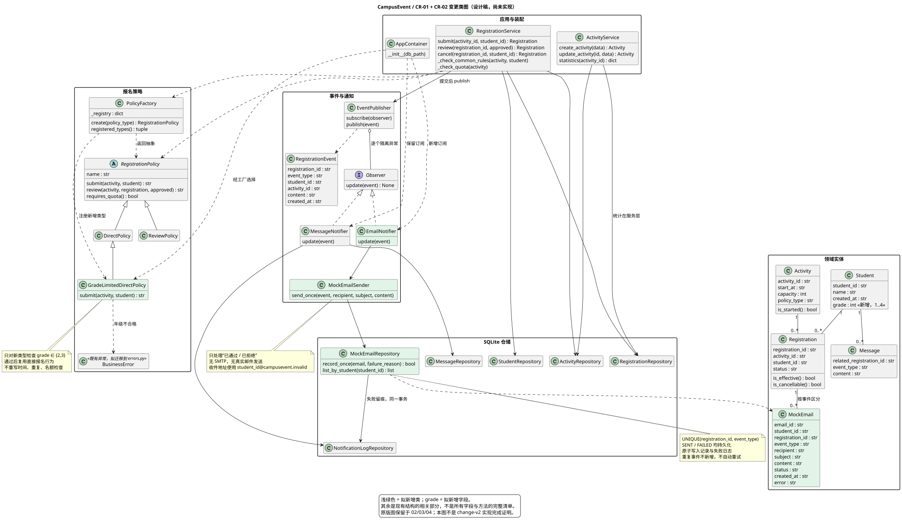
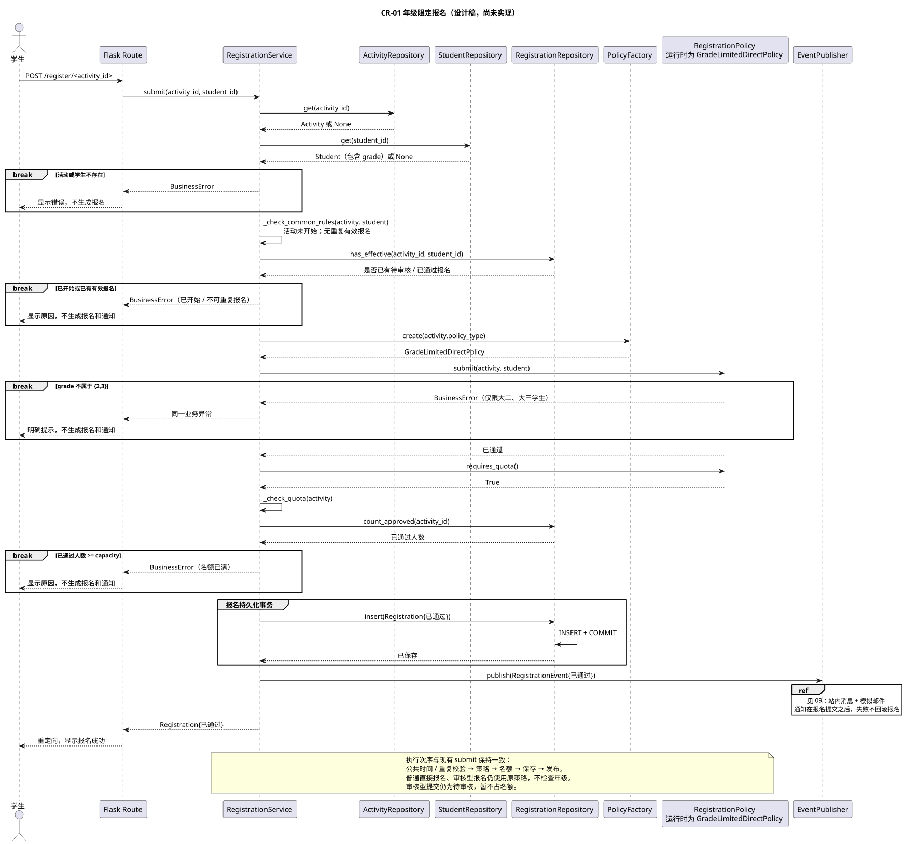
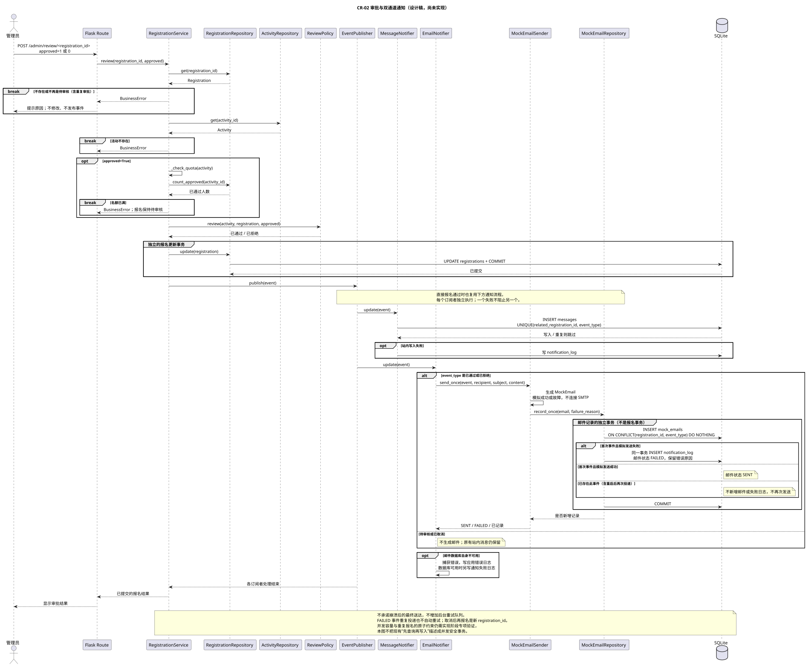

# CR 变更图与版本说明

日期：2026-11-26。依据：用户本次提供的教师材料中 CR-01、CR-02，以及指导书 3.3、3.6、3.8。

**图已按变更实现核对更新。** 此前设计稿保存在提交 `995b351`；当前图对应年级策略、模拟邮件、数据库去重和失败处理的实际实现。测试证据在 `docs/verification/`。线上升级与同学签字不由本地验证替代。

## 图表入口

| 阶段 | 图 | 源文件 |
|---|---|---|
| 初版历史材料，保持原文件 | [初版 UML 类图](02_UML类图.svg) | [PlantUML](02_UML类图.puml) |
| 初版历史材料，保持原文件 | [初版报名时序](03_时序图_报名.svg) | [PlantUML](03_时序图_报名.puml) |
| 初版历史材料，保持原文件 | [初版审批时序](04_时序图_审批.svg) | [PlantUML](04_时序图_审批.puml) |
| CR 变更实现版 | [变更 UML 类图](07_UML类图_变更设计.svg) | [PlantUML](07_UML类图_变更设计.puml) |
| CR 变更实现版 | [年级限定报名时序](08_时序图_年级限定报名.svg) | [PlantUML](08_时序图_年级限定报名.puml) |
| CR 变更实现版 | [审批与双通道通知时序](09_时序图_审批与双通道通知.svg) | [PlantUML](09_时序图_审批与双通道通知.puml) |

新图同时提供同名 PNG，方便插入报告。为保留图文链接，文件名仍含“变更设计”，图标题已注明实现版。具体设计原则和代价见 [变更版设计原则](10_变更版设计原则.md)。

## 变更 UML 类图



## 年级限定报名



## 审批与双通道通知



## “不变”的含义

- 只给新活动类型增加年级限制。大一、大四学生参加普通直接报名或审核型活动的原规则不变。
- 时间、名额、重复有效报名仍是公共约束；年级符合不等于可以绕过这些约束。
- 站内消息继续存在，邮件是附加渠道。待审核、已取消的站内消息也不因新增邮件而取消。
- 通知失败不改变已经提交的报名。重复业务动作与重复事件都需要测试。
- 尽量保持 `RegistrationService` 核心流程稳定，不等于数据库、字段、注册表、后台校验和页面一律不能改。

## 相比历史图的校正

原图保留是为了保存历史，不表示其中每一处标注都与现有实现一致。新图不重复以下偏差：

| 历史材料的问题 | 现有代码事实 / 新图处理 |
|---|---|
| `Activity` 画有 `approved_count()`、`remaining_quota()` | 现有实体没有这两个方法，统计由 `ActivityService.statistics()` 和仓储查询完成 |
| 报名图用 `RegistrationRepository.get(activity_id)` 读取活动 | 活动与学生分别由 `ActivityRepository`、`StudentRepository` 读取 |
| 报名图先检查名额，再调用策略 | 当前顺序是公共时间/重复校验、策略、按状态检查名额、保存、发布 |
| 审核型提交图也执行 `_check_quota()` | 当前提交为待审核，不检查占用名额；批准时才检查 |
| 图中先 `exists_once()` 再写消息 | 当前通知实际直接插入，由数据库唯一索引防重复 |
| 审批、取消的 URL 与实际路由不一致 | 实际为 `/admin/review/<registration_id>`、`/cancel/<registration_id>` |
| 部分设计文字称工厂是服务中的 if/else | 当前已使用 `PolicyFactory._registry` 注册表 |
| 文档称新增策略只需一个类，仓储永不修改 | CR-01 同时涉及学生字段、SQLite 约束、仓储映射、校验、页面和测试 |

详细设计选择、异常依赖处理、数据库迁移方案与测试清单见 [变更影响分析](../docs/变更影响分析.md)。

## 渲染复现

本次使用 PlantUML 1.2024.8。本机 Java 8 可运行；类图选择内置 Smetana，免安装 Graphviz。图片由 `.puml` 源文件生成，不是手工修改的截图。

在仓库根目录运行，`<plantuml.jar>` 替换为本机安装的 JAR 路径：

```powershell
$files = Get-ChildItem -LiteralPath design -Filter '*.puml' | Where-Object { $_.Name -match '^(07|08|09)_' }
$files | ForEach-Object { java '-Dfile.encoding=UTF-8' -jar '<plantuml.jar>' -charset UTF-8 -checkonly $_.FullName }
$files | ForEach-Object { java '-Dfile.encoding=UTF-8' -jar '<plantuml.jar>' -charset UTF-8 -tsvg $_.FullName }
$files | ForEach-Object { java '-Dfile.encoding=UTF-8' -jar '<plantuml.jar>' -charset UTF-8 -tpng $_.FullName }
```

中文显示需要安装支持中文的字体。已有的初版图不在上述重渲染范围内。
